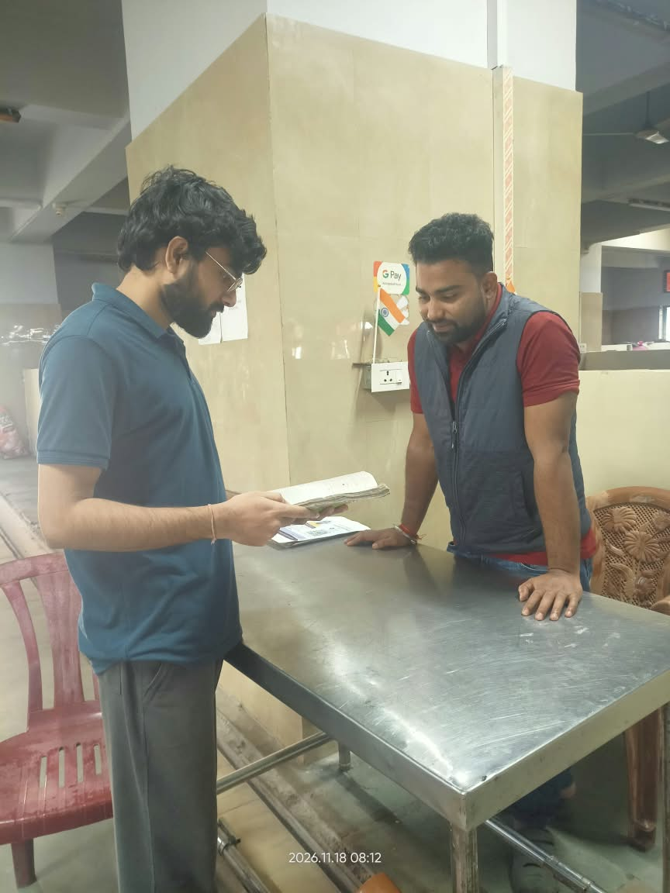
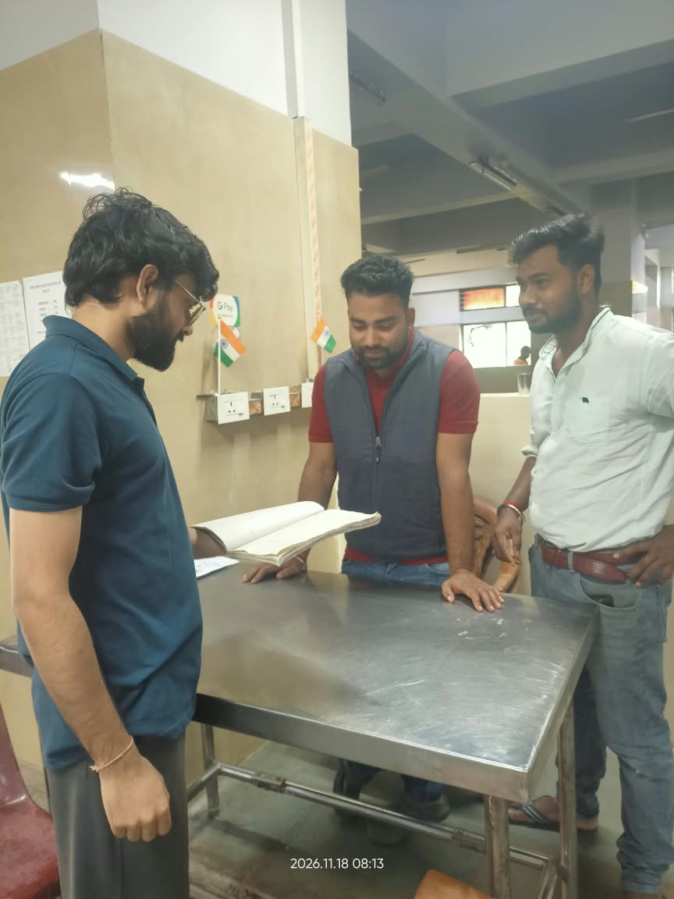
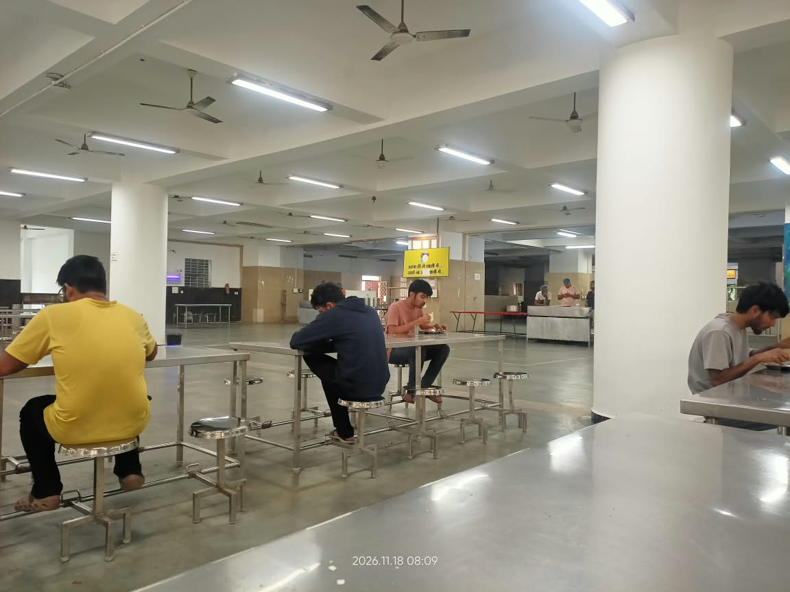

# Fieldwork — HostelMeal (Dinner Only)

## Visit details

- **Date:** 17 November 2026
- **Location:** Mega Mess
- **Person spoken to:** Tarun
- **Role:** Mess Supervisor
- **Observation period:** 25 minutes 
- **Photos:** I have uploaded 3 timestamped pictures with the mess supervisor discussing the issues.  Confirm that both image files are present in the repository.

## What the supervisor raised

The following points are recorded as summaries of the student's notes:

1. Food is being wasted.
2. Attendance and food-demand estimates rely on human judgement and can be inaccurate.
3. Inaccurate estimates can cause financial loss.

## Observation and surprise

- **Surprise:** I observed that food wastage was higher than expected and this is happening on daily basis from a long time .

## How this connects to the project

The conversation suggests that dinner demand estimation may help the mess plan food quantities more carefully. HostelMeal currently makes separate estimates for main-mess dinner attendance and night-canteen visits using menu and weekday similarity.

## Details to complete before submission

- Add the exact 20-minute observation start and end time.
- Add the two timestamped photo filenames (and ensure the files are in `evidence/`).
- Add three concrete observations from the visit, if recorded (for example, how food was prepared, served, or left over). Do not invent details.
- If the supervisor gave specific examples or exact wording, add them accurately and mark direct quotations with quotation marks.
- Ask whether the supervisor is comfortable being identified by name in the public repository; anonymise the name if not.

## Count definitions to verify

- **Main-mess dinner attendance:** Clarify whether this is a count of unique students, plates served, or another measure.
- **Night-canteen visits:** Clarify whether repeat visits by the same student are counted more than once.
- Keep the two measures separate in `data.csv`.
